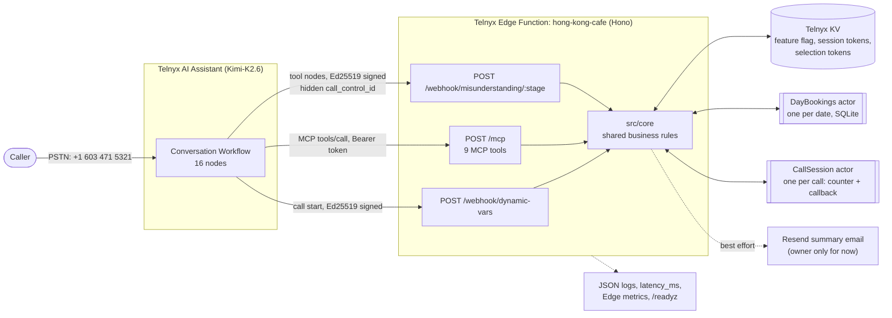
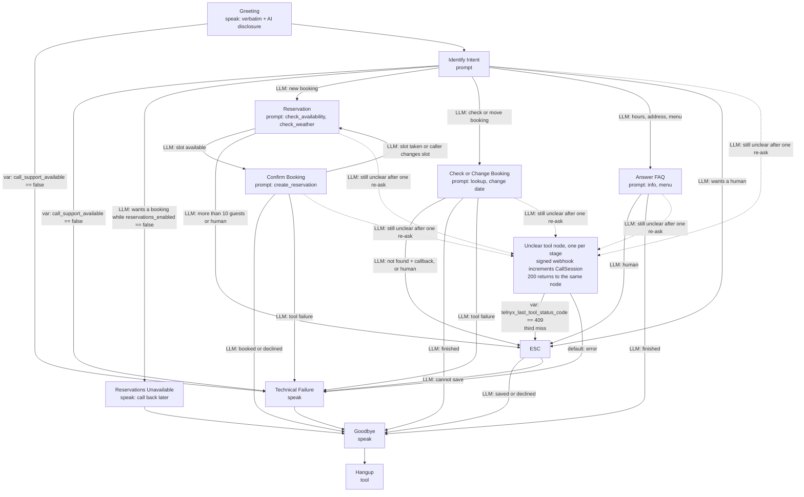

# Hong Kong Cafe — Telnyx Voice AI Receptionist

A phone receptionist for a fictional Hong Kong restaurant. Callers can **book a table**,
**check or move an existing booking**, ask about **hours, address, or today's dinner menu**,
and **request a human callback**. Everything runs on Telnyx: an AI Assistant with a 16-node
Conversation Workflow, a public MCP server, and a dynamic-variables webhook, all served by one
Telnyx Edge Function backed by KV and two Stateful Actors.

## Live endpoints

| Item | Value |
| --- | --- |
| Phone number | **+1 603 471 5321** (US number, see [Limitations](#limitations)) |
| Edge Function | `https://hong-kong-cafe-ce4e4c94-b.telnyxcompute.com` |
| MCP server | `POST <function-url>/mcp` with `Authorization: Bearer <MCP_API_KEY>` |
| Dynamic variables | `POST <function-url>/webhook/dynamic-vars` (Telnyx Ed25519 signed) |
| Health | `GET <function-url>/readyz` |
| Assistant ID | `assistant-4df34ebc-c6b6-4efa-8996-ecc81b9d9a7b` |

Try: *"A table for four this Friday at 7 pm, outside please"*, *"What's on the dinner menu
today?"*, *"Can I move my booking to next Tuesday?"*, *"Can I talk to a person?"*

## Why this use case

Restaurant phone booking is a real multi-step problem that exercises every part of the
challenge: a structured conversation (collect, check, confirm), tools with real side effects,
per-entity state with a genuine race (two callers taking the last table), and a safe human
handoff when the call goes wrong.

## Telnyx components

| Component | How it is used |
| --- | --- |
| AI Assistant (Assistants API) | Voice agent on Telnyx-hosted `moonshotai/Kimi-K2.6`, provisioned idempotently by `scripts/provision-assistant.mjs` |
| Conversation Workflow | 16 nodes (4 speak, 6 prompt, 6 tool) with LLM and variable-comparison edges |
| Dynamic Webhook Variables | Call-start variables that **route** the workflow and carry a trusted session token |
| Edge Function | One Hono app serving the webhook, MCP server, and shared-tool endpoints; deployed with `telnyx-edge ship` |
| KV | Reservation feature flag, call-session tokens, booking selection tokens |
| Stateful Actors | `DayBookings` (one per date) and `CallSession` (one per call) |
| Shared webhook tools | Deterministic misunderstanding counters with a hidden `call_control_id` |
| Edge logs and metrics | Structured JSON logs, invocation and error metrics |
| Telnyx Inference + OpenCode | AI coding models used to build the project |
| Phone number | `+1 603 471 5321`, assigned to the Assistant |

## Architecture



All three HTTP adapters call the same pure TypeScript rules in `src/core/`, so the MCP and
webhook paths cannot disagree about reservations.

## Conversation flow



Workflow design decisions:

- **Speak nodes** hold text that must be verbatim: greeting with AI disclosure, technical
  failure, goodbye.
- **Prompt nodes use `instructions_mode: "append"`** so the global guardrails (never invent a
  booking, booking privacy, always pass the session token) stay active and each node only adds
  its own step. `replace` would silently drop those guardrails.
- **Variable-comparison edges** for anything that must not depend on the model: both dynamic
  variable flags and `telnyx_last_tool_status_code`. With `reservations_enabled == "false"`
  the caller is not rejected up front: FAQ questions still work, and only when they ask to book,
  check, or move a reservation does Identify Intent route to the verbatim Reservations
  Unavailable message. Reservation, Confirm, and Check/Change repeat the variable edge as a
  backstop.
- **LLM edges** only for conversational judgement: intent, slot accepted, caller finished.
- **Trade-off:** LLM edges are flexible but non-deterministic, so the model never counts
  misunderstandings. Unclear tool nodes call a signed shared webhook with the hidden preset
  `call_id = {{call_control_id}}`; the `CallSession` actor returns `200`, or `409` on the third
  miss.
- **Tool scoping:** the Assistants API attaches MCP tools at assistant level (there is no
  per-node selector), so each node's instructions name the only tools it may use, and
  `record_misunderstanding` is excluded from the Assistant's allowed tools.

## MCP server

Why MCP instead of separate webhook tools: one authenticated endpoint, tool discovery through
`tools/list`, JSON Schemas generated from zod and validated server-side, and the same tools can
be tested with any MCP client (the smoke scripts use the official MCP SDK). The transport is
stateless Streamable HTTP JSON-RPC (`initialize`, `tools/list`, `tools/call`) with
constant-time bearer authentication.

| MCP tool | Purpose | Reason |
| --- | --- | --- |
| `get_restaurant_info` | Opening hours or address | Grounds answers in data instead of model guesses |
| `get_daily_menu` | Dinner menu for today or a date | The menu changes by weekday; the model cannot know it |
| `check_availability` | Validates date, time, and party; offers up to 3 alternatives (same day, then the next 7 days); issues a 10-minute `selection_token` | The server, not the model, decides availability; the token pins the validated slot |
| `check_weather` | Deterministic demo forecast (weekend rain, weekday sun) | Gates outdoor seating |
| `create_reservation` | Atomic booking in that date's `DayBookings` actor | `selection_token` is the idempotency key, so retries never double-book |
| `lookup_reservation` | Finds a booking by name or surname + phone + date | Privacy: every mismatch returns the same `not_found` |
| `change_reservation_date` | Moves a verified booking to a new date at the same time | Re-verifies identity, then moves the row between date actors |
| `request_callback` | Saves one callback per call in `CallSession` and emails a summary (owner only, see [Limitations](#limitations)) | Human handoff; retries return `already_saved` |
| `record_misunderstanding` | Increments the per-call counter | Smoke tests only; the workflow uses signed tool nodes instead |

## Dynamic webhook variables

Called at call start. The function verifies the Ed25519 signature and a five-minute timestamp
window, then returns `{ "dynamic_variables": { ... } }`.

| Variable | Source | Effect on the call |
| --- | --- | --- |
| `call_support_available` | `"true"` only when a session token was written to KV | `"false"` **routes** to Technical Failure |
| `reservations_enabled` | KV key `feature/reservations_enabled` | `"false"` **routes** a booking request to a verbatim "not taking reservations, please call back later" message (FAQ still answered), without redeploying |
| `call_session_token` | Random token mapped to the trusted `call_control_id` in KV (4 h TTL) | Passed to MCP tools so the server never trusts a model-supplied call ID |
| `today_date`, `is_open_now` | Hong Kong clock | Resolves "tomorrow" or "Friday" correctly |
| `restaurant_name`, `restaurant_address` | Static data | Greeting and FAQ wording |

Both routing variables default to `"false"` on the Assistant, so a webhook timeout fails safe.

## State: Actor vs KV vs plain code

| State | Primitive | Why |
| --- | --- | --- |
| Reservations for one date | `DayBookings` actor, embedded SQLite + `transactionSync` | Capacity check + insert is a read-modify-write; the single-threaded actor prevents double-booking. Sharding by date avoids one global bottleneck |
| Misunderstanding count and callback for one call | `CallSession` actor | Per-call increments must never be lost; the first callback wins |
| Reservation feature flag | KV | Read-mostly; changes workflow routing without a redeploy |
| Session and selection tokens | KV with TTL | Short-lived lookups, no read-modify-write, automatic expiry |
| Hours, address, menu | Code constants | Static; changes ship with the code |

Trade-off: an actor's SQLite is private, so there is no cross-date query. A staff view of all
bookings would need a different design.

## Edge cases and failure handling

- Requested slot full: up to 3 nearest same-day times. Whole day full: first available day
  within 7 days. Nothing found: callback.
- Parties over 10 go to callback; past times, dates beyond 30 days, and invalid party sizes
  are rejected.
- Two callers racing for the last seats: one `confirmed`, one `slot_taken` with fresh
  alternatives (live-verified).
- Retrying a booking with the same token returns `already_confirmed` and uses no extra seats.
- Tool errors tell the model "Do not assume it succeeded"; the workflow then plays a verbatim
  Technical Failure message instead of claiming success.
- Outside seating on a rainy day: indoor is offered. Wrong name, phone, or date on lookup:
  identical `not_found`.
- Signed webhooks reject bad signatures and stale timestamps (`403`); MCP rejects a missing or
  wrong bearer token (`401`).
- Phone numbers are masked in logs; session and selection tokens are never logged. The booking
  email is internal and never mentioned to callers.

## Observability

Every request logs one JSON line with `timestamp`, `event`, `request_id`, trusted
`correlation_id`/`call_id`, masked `caller`, `route`, `node`, `tool`, `outcome`,
`error_code`, and `latency_ms`.

Signals beyond logs:

- `latency_ms` on every webhook and MCP call, plus Edge invocation and error metrics.
- `GET /readyz` probes secrets, KV, and both actors.
- One call can be traced Assistant → dynamic variables → KV → MCP → Actor through its
  `call_control_id`, which MCP calls recover from the opaque session token.

**How I would know within a minute that the assistant is broken, and what I'd check first:**

1. `telnyx-edge metrics hong-kong-cafe --errors`: a 5xx spike, or invocations dropping to zero
   while calls are expected.
2. `curl <function-url>/readyz`: shows which dependency is down.
3. `telnyx-edge logs hong-kong-cafe --type runtime --since 15m`: filter on `"outcome":"failed"`,
   `mcp_rejected`, or `dynamic_variables_rejected`, then follow the failing call's `call_id`.

If the Edge side is healthy but calls still fail, the fault is on the Assistant side
(workflow, MCP attachment, or phone routing).

## Debugging story

Full evidence trail: [DEBUG_LOG.md](DEBUG_LOG.md). The hardest bug:

- **Symptom:** callers heard "technical issue saving the callback".
- **Signal:** runtime logs for that call showed `dynamic_variables_resolved` and two
  `request_callback` calls ending in `mcp_error`, but **no** `callback_saved` or
  `callback_failed` event. The missing service-level event proved the handler exited before
  the callback service, at zod validation, which logged nothing.
- **Cause:** the model sometimes sent the phone number as a JSON number; the string schema
  rejected it, and the Escalate node treated that as a system failure.
- **Fix:** coerce numeric phones, log invalid arguments by field name only, re-ask instead of
  failing, and store the callback in the `CallSession` actor. Verified live: `saved`, then
  `already_saved` on retry, with `callback_email_sent` logged exactly once.

Other real bugs: the reservations-disabled flag still led callers into booking or callback
questions because the only check sat on a prompt node (see [DEBUG_LOG.md](DEBUG_LOG.md));
MCP returned `503` because Edge secrets live in `process.env`, not the `env`
binding; live KV rejected `:` in keys; the first deploy stayed pending for about 21 minutes
(shown by deployment JSON and a `409` on re-ship, not an application crash).

## Telnyx Inference via OpenCode

- `@telnyx/opencode` is enabled in [.opencode/opencode.json](.opencode/opencode.json) and
  [.opencode/tui.json](.opencode/tui.json), authenticated with
  `opencode auth login --provider telnyx --method "API Key"`.
- Coding models, from OpenCode session history for this repository: mainly
  `deepseek-ai/DeepSeek-V4.1-Flash-1017`, plus `moonshotai/Kimi-K3`,
  `moonshotai/Kimi-K3.1-Pro`, `zai-org/GLM-5.2`, and `openai/gpt-oss-120b`.
- The Assistant itself runs on Telnyx-hosted `moonshotai/Kimi-K2.6`.

## Limitations

- **Phone number:** linking the Assistant to a Hong Kong number costs 75 USD, so it is
  connected to the US number **+1 603 471 5321** instead. I am not able to validate it by
  calling from my own phone, so the spoken workflow has not been verified end to end over a
  real phone call. I did confirm the reservations-disabled flow in a live test: with the KV flag
  off, FAQ questions are answered and a booking request gets the "call back later" message. The
  backend, MCP server, actors, KV, idempotency, concurrency, and callbacks
  are live-verified with the smoke scripts (see [DEBUG_LOG.md](DEBUG_LOG.md)).
- MCP tools cannot be scoped per workflow node through the Assistants API; node instructions
  do the scoping.
- Weather is a deterministic demo rule, not a live forecast.
- **Email summaries:** in the current setup only I (the project owner) receive the booking and
  callback summary emails. Resend's sandbox sender can only deliver to the Resend account
  owner's address; sending to the restaurant or anyone else needs a verified domain and
  `EMAIL_FROM`. Callers are never emailed.
- English only; no cancellation, payments, SMS, or staff dashboard.

## Setup and deployment

Requires Node.js 22.12+ and an authenticated `telnyx-edge` CLI (v0.5.17+).

```bash
cd hong-kong-cafe
npm install
npm run check                     # typecheck + vitest
telnyx-edge secrets add MCP_API_KEY "<random-token>"
telnyx-edge secrets add TELNYX_PUBLIC_KEY "<org-public-key>"
telnyx-edge storage kv key put <kv-id> feature/reservations_enabled true
telnyx-edge ship --yes

# MCP server, shared tools, Assistant and workflow (idempotent)
TELNYX_API_KEY=... MCP_API_KEY=... \
FUNCTION_URL=https://hong-kong-cafe-ce4e4c94-b.telnyxcompute.com npm run provision:assistant

# Live checks with the official MCP client
export MCP_URL=<function-url>/mcp MCP_API_KEY=...
npm run mcp:smoke
npm run mcp:business-smoke        # booking, idempotency, last-seat race
```

Secrets are injected as `process.env` at deploy time, so re-ship after changing one. Run
`telnyx-edge types` after changing actor bindings or exported actor methods.

## Stretch goals covered

Variable-comparison edges, a KV feature flag that changes routing without a redeploy, custom
dynamic variables that drive routing, and per-call correlation across Function → KV/Actor → MCP.

## Repository map

```text
DEMO_SCRIPT.md          Live-demo runbook
DEBUG_LOG.md            Evidence-based debugging record
PROJECT_BRIEF.md        Requirements and implementation contract
.opencode/              OpenCode config with the Telnyx plugin
hong-kong-cafe/
  telnyx.toml           Edge manifest: actor and KV bindings
  src/app.ts            Hono routes (src/index.ts exports the actors)
  src/actors/           DayBookings, CallSession
  src/core/             Pure business logic shared by MCP and webhooks
  src/mcp/              MCP transport and nine tools
  src/routes/           Dynamic variables, MCP, misunderstanding webhooks
  workflow/             Assistant and workflow definition
  scripts/              Provisioning and live smoke tests
  tests/                Vitest suite
```

